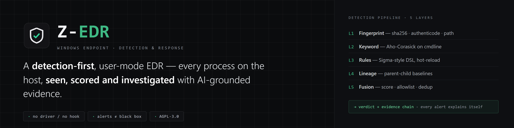
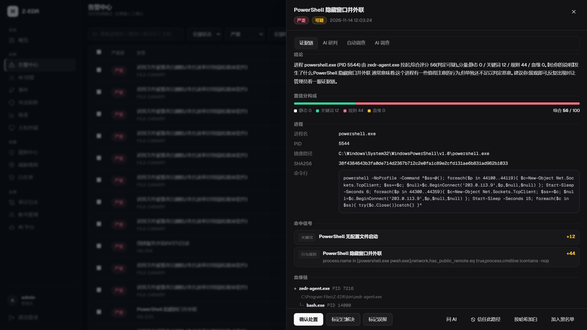
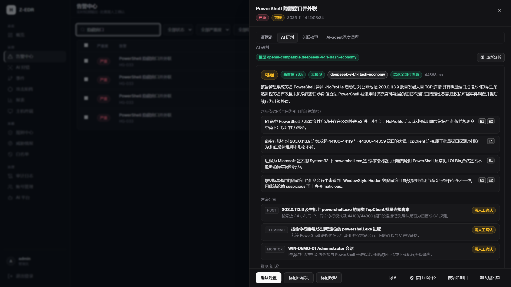
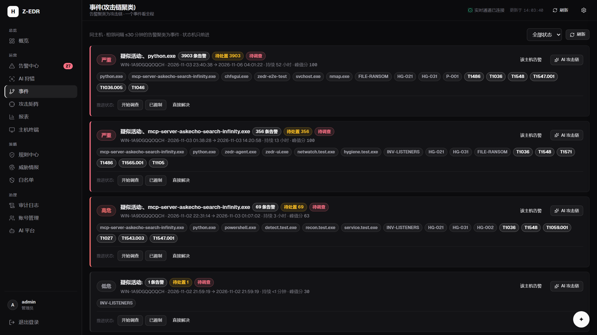
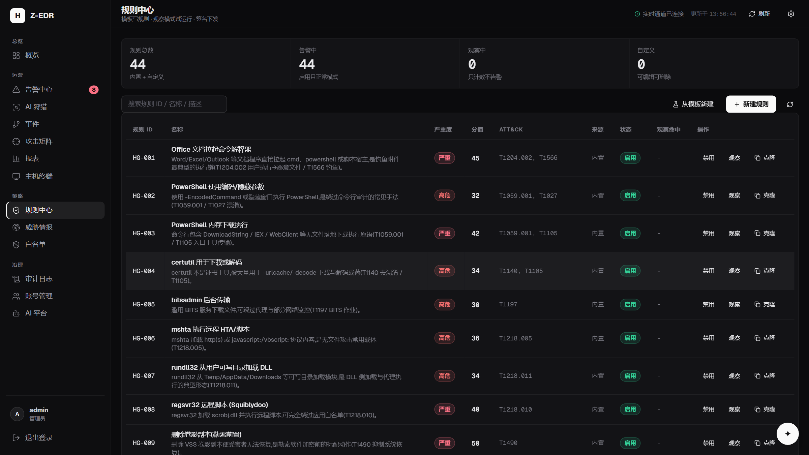
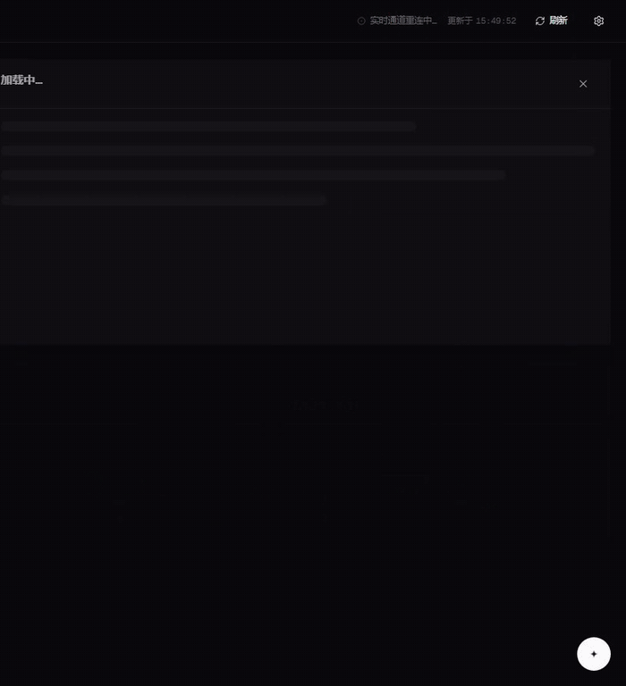

# Z-EDR

**A detection-first, user-mode EDR for Windows & Linux hosts — with an AI-native investigation console.**

[](https://go.dev)
[](https://www.microsoft.com/windows-server)
[](https://www.kernel.org/)
[](#)
[](LICENSE)

**English** | [中文](README.zh-CN.md)

<p align="center">
  
</p>

Z-EDR records process, file-drop, persistence, network and event-log telemetry
on Windows and Linux endpoints, scores it with a five-layer detection pipeline
mapped to MITRE ATT&CK, clusters alerts into incidents, and gives analysts an
investigation console with AI triage, live forensics and human-approved
response actions.

It runs **entirely in user mode** — no kernel driver, no hooking, no process
injection, and no inline blocking. Z-EDR is an *EDR* (detect & respond), not an
*EPP* (prevent & block). Uninstalling leaves no trace.

> **Experimental** — stability is not guaranteed yet; validate against your
> own environment before relying on it.

---

## The console

<p align="center">
  
</p>
<p align="center"><sub>Duty briefing (deterministic aggregation, zero model calls) · alert trend & severity distribution · host / rule / ATT&CK rankings</sub></p>

<p align="center">
  
  
</p>
<p align="center"><sub>Evidence chain with score composition — left · AI verdict: every claim cites its evidence id (E1/E2), every action waits for human confirmation — right</sub></p>

<p align="center">
  
  
</p>
<p align="center"><sub>ATT&CK coverage matrix (hits vs. static coverage) — left · alerts clustered into incident chains with a disposition state machine — right</sub></p>

<p align="center">
  
  
</p>
<p align="center"><sub>Rules center with shadow mode &amp; one-click promotion — left · natural-language hunting compiled to a safe DSL (the model never sees SQL) — right</sub></p>

<p align="center">
  
  
</p>
<p align="center"><sub>Host detail: services / tasks / autoruns / live files / recon / baseline / accounts / changes — left · three-step onboarding (bundle + token + one command) — right</sub></p>

<p align="center">
  
</p>
<p align="center"><sub>One alert, end to end: open the evidence chain, request an AI verdict — every claim cites its evidence, every action waits for a human</sub></p>

## Highlights

- **Five-layer detection** — static fingerprints, keyword matching, Sigma-style
  JSON DSL behavioral rules (server-delivered, hot-reloadable), parent-child
  lineage baselining, and score fusion. Every alert carries an explainable
  evidence chain.
- **Dual-platform agent** — the same five-layer engine and detector families
  run on Windows and Linux: Linux collects via procfs, watches file changes
  through inotify, baselines persistence from cron/systemd/ssh profiles and
  serves the live tunnel + investigation endpoints (first machine validated
  on Kali 2025.4); Windows adds response actions, memory scanning, event-log
  ingestion and ETW.
- **Broad behavioral telemetry** — file-drop monitoring, USN Journal catch-up
  for drops that happened while the agent was stopped, persistence monitoring
  with baseline-on-first-run, registry autorun watch, network behavior detectors
  (port scan / sweeps / lateral fan-out), ransomware canaries + delete/rename
  rate defense, Windows event-log ingestion, and host inventory change events.
- **Attack-chain correlation** — an EQL-style on-endpoint state machine links
  individual signals into chains (drop→execute→C2, persistence→run,
  injection→outbound), each stage referencing the alert that fed it.
- **AI-native investigation** — grounded AI triage (every claim cites evidence,
  prompt-injection hardened, deterministic fallback without a model), natural-
  language hunting compiled to a safe DSL, agentic alert investigation, cross-
  alert incident narratives, an in-console AI assistant, and a critical-alert
  duty queue — all routed through one configurable AI platform with per-task
  model slots, prompt overrides, budgets and an eval gate (44 synthetic
  fixtures with a deterministic scorer).
- **Live forensics over a callback tunnel** — the agent opens **zero listening
  ports**: it dials back over an outbound-only yamux tunnel and serves its
  local HTTP API through it, so the console, MCP clients and AI agents can
  reach 30 read-only investigation endpoints (processes, connections, files,
  registry, event logs, tasks, services, drivers, logon sessions,
  ARP/route/DNS cache, USN, PE analysis, evidence zip collection) in real
  time — even on tightly firewalled endpoints. This live channel is what lets
  the agentic investigation pull fresh endpoint evidence instead of working
  from a static alert snapshot.
- **Fleet operations** — enrollment + three-step onboarding, signed rule / IOC /
  intel packs (HMAC, dual v1/v2 signatures for mixed fleets), a rules center
  with shadow mode (observe → count → promote), ATT&CK coverage matrix,
  incident state machine with MTTA, IM/email notifications, daily backups,
  Prometheus metrics, offline-sensor alerting, and signed agent self-upgrade.
- **Human-approved response** — `terminate` and file `quarantine`/`restore`
  behind server + agent switches, **off by default**, every action audited.
  Detection drills (five controlled self-tests) are also double-switched and
  off by default.
- **Low, measured footprint** — 0.68% CPU / 24.7 MB RSS on the reference host
  (~250 processes, 2 s scan interval, adaptive backoff when idle); single-
  process detection ≈25 ms; server ingest ≈871 alerts/s sustained.

## Design principles

**Who Z-EDR is for:** mixed Windows & Linux fleets and desktops, self-hosted
and homelab setups, regulated environments that must avoid kernel drivers, and
teams that want every AI judgment tied to inspectable evidence. **Not for:**
prevention-first (EPP) needs or kernel-grade tamper protection. Linux support
is young — first machine validated on Kali, response actions are Windows-only
— so mission-critical Linux-only estates should evaluate carefully.

1. **Detection, not prevention.** No inline blocking or filesystem filters —
   Z-EDR works after the fact: record, detect, investigate, respond.
2. **User mode, low intrusion.** Only documented user-mode APIs. Nothing is
   patched or injected; uninstalling leaves no trace.
3. **Response is opt-in.** Nothing is killed or quarantined without explicit
   configuration and human approval.
4. **Honest limits.** Polling-based collection has a TOCTOU window for
   short-lived processes, and there is no tamper protection. Measured detection
   results are published as-is, including misses — see [Testing](#testing) and
   the known-limitations list.

## How Z-EDR compares

Statements below describe each project's public documentation and source at the
time of writing (2026-11); corrections welcome.

| | Z-EDR | Wazuh | Falco | Velociraptor |
|---|---|---|---|---|
| **Focus** | Windows & Linux EDR (Linux experimental): detect, investigate, respond | Cross-platform SIEM / HIDS platform | Cloud-native runtime security for Linux | Endpoint visibility & DFIR |
| **Deploy shape** | one server binary (embedded UI, SQLite) + one agent | manager + indexer + dashboards stack | agent + rules, CNCF ecosystem | server + client, VQL-driven |
| **Collection model** | user-mode APIs only — no driver, no hook | agent (log & state collection) | kernel module or eBPF on syscalls | agent (osquery-like artifacts) |
| **Real-time behavioral detection** | 5-layer pipeline + attack-chain + ransom/netwatch/event-log families | rule-based log analysis + FIM | syscall rule engine | monitoring via VQL artifacts (DFIR-first) |
| **AI-assisted investigation** | grounded triage, NL hunting, agentic investigation, incident narratives | — | — | — |
| **Response** | terminate / quarantine, off by default, human-approved, audited | active-response scripts (configurable automation) | alerts (forwarding via Falcosidekick) | remote shell / artifact collection |
| **Best when** | you need per-process evidence and explainable AI on Windows & Linux, without kernel drivers | you need a full SIEM stack with compliance content | you need Linux/container runtime alerting | you need deep fleet queries and forensic collection |

## Architecture

<p align="center">
  
</p>

| Component | Binary | Role |
|---|---|---|
| Server | `zedr-server.exe` | REST API, SQLite, embedded web console, JWT/RBAC, signed rule/IOC/intel delivery, AI orchestration, MCP tools |
| Agent | `zedr-agent.exe` / `zedr-agent-linux` | Collection + detection + attack-chain engine + uplink; Windows service install, Linux run under systemd/supervisor |
| Desktop panel | `zedr-ui.exe` | WebView2 window for local status & hygiene views (falls back to browser) |
| Diagnostics | `zedr-diag.exe` | Collector self-check (`-compare`, `-persist`, `-usn`, `-hold`, `-spawn`, `-chaintest`, `-netburst`, `-memtestout`) |

## Detection model

| Layer | What | Typical signal |
|---|---|---|
| L1 | Static fingerprint | known-bad SHA256, Authenticode (incl. catalog), path reputation |
| L2 | Keyword | Aho-Corasick multi-pattern scan of command lines |
| L3 | Behavioral rules | Sigma-style JSON DSL rules, server-delivered & hot-reloadable |
| L4 | Lineage graph | parent-child frequency baselines, rare pairs, orphan processes |
| L5 | Fusion | thresholds (≥70 malicious / ≥38 suspicious), allowlist, dedup, warm-up silence |

Beyond the pipeline, dedicated detector families emit their own alert IDs:
`CHAIN-*` (attack chains), `NW-001..005` (network behavior), `FILE-CANARY` /
`FILE-RANSOM` (ransomware defense), `EVT-*` (event log), `INV-*` (inventory
drift), `SEN-OFFLINE` (sensor loss). Detection **drills** let one host rehearse
five controlled self-tests end-to-end (process chain, port scan, service event,
registry run, canary touch) — self-made samples only, double-switched, off by
default.

## Quick start

**Requirements:** Windows 10 / Server 2016+ (x64); Linux kernel 3.2+ (x64,
Kali 2025.4 validated); Go 1.27+ (no CGO).

```bash
git clone https://github.com/poq79/zedr.git && cd zedr
go mod download
bash scripts/build.sh            # or: go build -o bin/zedr-server.exe ./cmd/server
cp .env.example .env             # set HG_SERVER_JWT_SECRET + HG_SERVER_ENROLL_TOKEN
./bin/zedr-server.exe            # first run prints the bootstrap admin password once
./bin/zedr-agent.exe             # point it at the server via HG_AGENT_SERVER_URL
```

**Linux agents:** `bash scripts/build.sh linux` produces `bin/zedr-agent-linux`
(+ server) — copy to the host, point `HG_AGENT_SERVER_URL` at the server, and
run it under systemd or your supervisor. Platform deltas are listed in
[Known limitations](#known-limitations).

Console: `http://127.0.0.1:8080` · local panel: `http://127.0.0.1:8843` (loopback only).

**Desktop panel**: launch `bin\zedr-ui.exe` for a native frameless window
(custom titlebar, system-tray notifier, close-to-tray). It auto-connects to
the local agent and starts it if it is not running. The UI process does
nothing in the background — closing the window frees its memory while the
tray notifier and the agent service keep protecting.

Beyond detection, the local panel ships read-only hygiene views: installed
software (with hidden-uninstaller flags), Autoruns-style startup audit
(signature / file-missing flags), security posture & patch checks
(green/yellow/red with reasons), network exposure (listeners → process,
hosts, proxy), and browser extension review — evidence and guidance only,
no one-click "fixing".

Install the agent as a Windows service (auto failure-recovery configured):

```powershell
.\bin\zedr-agent.exe -install     # start + auto-start on boot
.\bin\zedr-agent.exe -uninstall   # stop + remove
```

**Deploy to a second machine** — the console's *Hosts → Onboard host* page closes
the loop: download the deploy bundle (agent + tray + install scripts), copy the
enrollment parameters, and run one command on the target:

```powershell
.\install-agent.ps1 -Url http://<server>:8080 -Token <enroll-token> [-Tags a,b] [-WithUI]
```

The script is idempotent (rerun = reinstall), exits with stable codes (0 enrolled
/ 2 privileges / 4 arguments), and fleets verify via `-status -json` (`online`).

All configuration is environment variables (`HG_*`), validated at startup — see
[`.env.example`](.env.example) for every option with comments, and
[CONFIGURATION.md](CONFIGURATION.md) for the domain-grouped map (which keys
toggle what, env vs hot-reload policies, key derivation chain).

## Safety defaults

| Capability | Default | Switch |
|---|---|---|
| Process terminate | **off** | `HG_SERVER_KILL_ENABLED` + `HG_AGENT_KILL_ENABLED` |
| File quarantine / restore | **off** | `HG_SERVER_QUARANTINE_ENABLED` + `HG_AGENT_QUARANTINE_ENABLED` |
| Live file-content read | **off** | `HG_SERVER_LIVEQUERY_FILEREAD` |
| Live queries (read-only) | on | `HG_SERVER_LIVEQUERY_ENABLED` |
| Evidence zip collection | **off** | `HG_SERVER_LIVEQUERY_COLLECT` |
| Detection drills | **off** | `HG_SERVER_DRILL_ENABLED` + `HG_AGENT_DRILL_ENABLED` |
| Agent self-upgrade | **off** | see `.env.example` |

Response actions are audited, RBAC-gated, and never automatic.

## Interfaces

- **Agent API** (API key): enroll, heartbeat, alert ingest, rule fetch, command result, tunnel upgrade.
- **Console API** (JWT): dashboard, alerts, incidents, hosts, inventory, commands, live queries, ATT&CK matrix, IOCs/intel, rules, allowlist, audit, users, SSE stream.
- **MCP tools** (Bearer token, read-only): alert/incident/intel queries plus
  `host_live` — real-time on-endpoint forensics. Every tool call is audited;
  the AI assistant in the console shares the same toolset.
- **Public**: `/health`, `/ready`, `/metrics` (Prometheus text format).

Every `HG_*` switch — including the safety defaults above — is documented with
comments in [`.env.example`](.env.example).

## Testing

```bash
go vet ./...                          # static analysis — must be clean
go test ./...                         # unit + integration (temp SQLite)
bash scripts/simulate_detection.sh    # controlled end-to-end run (self-made samples only)
python scripts/scenarios.py all       # detection matrix / false positives / perf / load
```

Samples are limited to self-built binaries, constructed command lines and the
EICAR string — no external executables are ever downloaded. Latest measured
round, published as-is: **13/17** scripted scenarios detected (the misses are
documented blind spots, not hidden), steady-state false positives **0** on the
long-running reference host, 3 of 4 attack-chain rules verified end-to-end,
and the AI eval gate (44 fixtures incl. prompt-injection) fully green.

## Known limitations

- User-mode polling (2 s, adaptive) can miss processes shorter than one
  interval (TOCTOU); file-drop monitoring and USN catch-up partially
  compensate. An ETW consumer exists behind a build tag but failed validation
  on Windows Server 2022 — disabled.
- Alert delivery is at-least-once (replays absorbed by server-side
  fingerprint dedup); Authenticode uses local caches without online
  revocation; intel feeds are manually maintained.
- No kernel-level blocking or tamper protection, by design.
- **Linux agent (experimental)**: shares the detection engine and detector
  families with Windows — procfs collection, inotify file watch, persistence
  baselines from cron/systemd/ssh profiles, netwatch, attack chains, ransom
  canaries, and the callback tunnel with its live investigation endpoints.
  First machine validated on Kali 2025.4. Response actions, memory scanning,
  event-log ingestion, ETW, recon and the desktop panel are Windows-only.

## Contributing

Issues and PRs welcome — run `go vet ./...` and `go test ./...` first, and
keep changes focused. Enable the local secret scanner once per clone
(`bash scripts/install-hooks.sh`): it blocks private keys, common token
formats and `.env`-style files at commit time.

## Acknowledgements

Every line of this codebase was written by **GLM-5.3-Flash**, running inside
the ZCode coding agent — thanks to ZCode's free nightly idle-token quota.

## License

Released under the **GNU Affero General Public License v3.0** (`AGPL-3.0-only`)
— see [LICENSE](LICENSE). The AGPL is the same model used by comparable
open-source DFIR platforms (e.g. Velociraptor): modifications — including those
of a version served over a network — must stay under the AGPL.

Copyright © 2026 poq79
