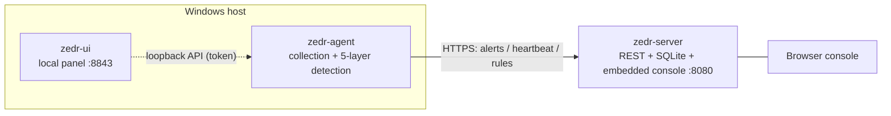

# Z-EDR

**A detection-first, user-mode EDR for Windows hosts.**

[](https://go.dev)
[](https://www.microsoft.com/windows-server)
[](#)

**English** | [中文](README.zh-CN.md)

Z-EDR records process, file-drop and persistence telemetry on Windows endpoints,
scores it with a five-layer detection pipeline mapped to MITRE ATT&CK, and gives
analysts an investigation console with human-approved response actions.

It runs **entirely in user mode** — no kernel driver, no hooking, no process
injection, and no inline blocking. Z-EDR is an *EDR* (detect & respond), not an
*EPP* (prevent & block).

---

## Highlights

- **Five-layer detection** — static fingerprints, keyword matching, 36 built-in
  behavioral rules (Sigma-style JSON DSL, hot-reloadable), parent-child lineage
  baselining, and score fusion. Every alert carries an explainable evidence chain.
- **Behavioral telemetry** — file-drop monitoring (`ReadDirectoryChangesW` on
  high-value directories), **USN Journal catch-up for file drops that happened
  while the agent was stopped**, and persistence monitoring (Run keys, startup
  folder, services, scheduled tasks, Winlogon, IFEO) with baseline-on-first-run.
- **Delivery you can trust** — alerts spool to disk (segmented NDJSON, bounded,
  replayed after restart/offline), rule packs are strictly validated at load
  time (unknown fields/operators are rejected instead of silently never
  matching), and per-agent ingest backpressure protects the server database.
- **Investigation workspace** — alert clustering into incidents, per-host
  timeline, integrity-chained audit trail, AI triage (grounded citations,
  prompt-injection resistant, pluggable backend, deterministic fallback), and
  natural-language threat hunting compiled to a safe DSL (never SQL).
- **Human-approved response** — `terminate` and file `quarantine`/`restore`
  behind server + agent switches, **off by default**, every action audited.
- **Fleet operations** — agent enrollment, signed rule/IOC delivery (HMAC),
  ATT&CK coverage matrix, 10-section host inventory with change events, live
  investigation tunnel (outbound-only, read-only whitelist), Scheduled/daily
  backup, webhook + Syslog CEF notifications, Prometheus metrics.
- **Low footprint** — ~1.4% CPU / ~34 MB RSS with 250+ processes on a 2 s scan
  interval (adaptive backoff when idle).

## Design principles

1. **Detection, not prevention.** No inline blocking or filesystem filters —
   Z-EDR works after the fact: record, detect, investigate, respond.
2. **User mode, low intrusion.** Only documented user-mode APIs
   (`NtQuerySystemInformation`, `ReadDirectoryChangesW`, registry/service
   enumeration). Nothing is patched or injected; uninstalling leaves no trace.
3. **Response is opt-in.** Nothing is killed or quarantined without explicit
   configuration and human approval.
4. **Honest limits.** Polling-based collection has a TOCTOU window for
   short-lived processes, and there is no tamper protection. These are
   deliberate trade-offs, documented in the repo history.

## Architecture



| Component | Binary | Role |
|---|---|---|
| Server | `zedr-server.exe` | REST API, SQLite, embedded web console, JWT/RBAC, rule & IOC delivery |
| Agent | `zedr-agent.exe` | Collection + detection + uplink; installable as a Windows service |
| Desktop panel | `zedr-ui.exe` | WebView2 window for local status (falls back to browser) |
| Diagnostics | `zedr-diag.exe` | Collector self-check (`-compare` engines, `-persist`, `-usn` catch-up probe, `-hold`, `-spawn`) |

## Quick start

**Requirements:** Windows 10 / Server 2016+ (x64), Go 1.22+ (1.27 tested), no CGO.

```bash
git clone https://github.com/poq79/zedr.git && cd zedr
go mod download
bash scripts/build.sh            # or: go build -o bin/zedr-server.exe ./cmd/server
cp .env.example .env             # set HG_SERVER_JWT_SECRET + HG_SERVER_ENROLL_TOKEN
./bin/zedr-server.exe            # first run prints the bootstrap admin password once
./bin/zedr-agent.exe             # point it at the server via HG_AGENT_SERVER_URL
```

Console: `http://127.0.0.1:8080` · local panel: `http://127.0.0.1:8843` (loopback only).
Beyond detection, the local panel ships read-only hygiene views: installed
software (with hidden-uninstaller flags), Autoruns-style startup audit
(signature / file-missing flags), security posture & patch checks
(green/yellow/red with reasons), network exposure (listeners → process,
hosts, proxy), and browser extension review — evidence and guidance only,
no one-click "fixing".

Install the agent as a Windows service (auto failure-recovery configured):

```powershell
.\bin\zedr-agent.exe -install     # start + auto-start on boot
.\bin\zedr-agent.exe -uninstall   # stop + remove
```

All configuration is environment variables (`HG_*`), validated at startup — see
[`.env.example`](.env.example) for every option with comments.

## Detection model

| Layer | What | Typical signal |
|---|---|---|
| L1 | Static fingerprint | known-bad SHA256, Authenticode (incl. catalog), path reputation |
| L2 | Keyword | Aho-Corasick multi-pattern scan of command lines |
| L3 | Behavioral rules | 36 Sigma-style JSON DSL rules, server-delivered & hot-reloadable |
| L4 | Lineage graph | parent-child frequency baselines, rare pairs, orphan processes |
| L5 | Fusion | thresholds (≥70 malicious / ≥38 suspicious), allowlist, dedup, warm-up silence |

## Safety defaults

| Capability | Default | Switch |
|---|---|---|
| Process terminate | **off** | `HG_SERVER_KILL_ENABLED` + `HG_AGENT_KILL_ENABLED` |
| File quarantine / restore | **off** | `HG_SERVER_QUARANTINE_ENABLED` + `HG_AGENT_QUARANTINE_ENABLED` |
| Live file-content read | **off** | `HG_SERVER_LIVEQUERY_FILEREAD` |
| Live queries (read-only) | on | `HG_SERVER_LIVEQUERY_ENABLED` |

Response actions are audited, RBAC-gated, and never automatic.

## Interfaces

- **Agent API** (API key): enroll, heartbeat, alert ingest, rule fetch, command result, tunnel upgrade.
- **Console API** (JWT): dashboard, alerts, incidents, hosts, inventory, commands, live queries, ATT&CK matrix, IOCs, rules, allowlist, audit, users, SSE stream.
- **Public**: `/health`, `/ready`, `/metrics` (Prometheus text format).

The full endpoint table and RBAC matrix live in the repository's internal docs.

## Testing

```bash
go vet ./...                          # static analysis — must be clean
go test ./...                         # unit + integration (temp SQLite)
bash scripts/simulate_detection.sh    # controlled end-to-end run (self-made samples only)
python scripts/scenarios.py all       # detection matrix / false positives / perf / load
```

Samples are limited to self-built binaries, constructed command lines and the
EICAR string — no external executables are ever downloaded.

## Known limitations

- Collection is user-mode polling (default 2 s, adaptive). Processes shorter
  than one interval can be missed (TOCTOU); file-drop monitoring partially
  compensates, and USN catch-up recovers drops during agent downtime. An ETW
  consumer implementation exists behind a build tag but is **not** enabled — it
  failed validation on Windows Server 2022.
- USN records carry only the leaf file name, so catch-up feeds the same
  base-name fallback used when path resolution is incomplete. Deletion records
  are ignored by design.
- Alert delivery is at-least-once: a crash after the server accepted a batch but
  before the spool segment was deleted can replay that batch; server-side
  fingerprint dedup absorbs the common case.
- No kernel-level blocking or tamper protection by design.
- Authenticode verification uses local caches; no online revocation checks.
- IOC library (SHA256) is manually maintained and signed for delivery; no
  automatic intelligence feeds yet.

## Contributing

Issues and pull requests are welcome. Please run `go vet ./...` and
`go test ./...` before opening a PR, and keep changes focused.

**Enable the local secret scanner** (recommended once per clone, zero dependencies):

```bash
bash scripts/install-hooks.sh
```

The pre-commit hook blocks commits that contain private keys, common token
formats (AWS/GitHub/Slack/Google), `.env`-style files, or non-placeholder
credential assignments. Bypass for a single commit with `git commit --no-verify`
(discouraged — if a real secret was committed, rotate it; cleaning history does
not make it safe). Full audit: `sh scripts/security/secret-scan.sh all`.

## License

A license is being selected before the first public release — see `LICENSE`
once added. Until then, all rights reserved.
