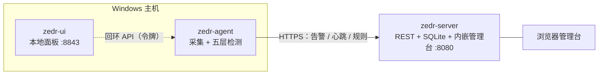

# Z-EDR

**面向 Windows 主机的检测优先、用户态 EDR。**

[](https://go.dev)
[](https://www.microsoft.com/windows-server)
[](#)

[English](README.md) | **中文**

Z-EDR 在 Windows 终端上记录进程、文件落地与持久化遥测，用五层检测流水线
（映射 MITRE ATT&CK）打分，并提供带**人工审批处置**的调查控制台。

全部能力在**用户态、低侵入**前提下实现——**零内核驱动、零 Hook、零进程注入、
不做执行前拦截**。Z-EDR 是 *EDR*（检测与响应），不是 *EPP*（执行前防御）。

---

## 核心能力

- **五层检测**——静态指纹、关键词匹配、36 条内置行为规则（Sigma 风格 JSON DSL，
  支持服务端下发与热更新）、父子链血缘基线、分值融合。每条告警都带可解释证据链。
- **行为遥测**——文件落地监控（`ReadDirectoryChangesW` 订阅高价值目录）+
  **USN Journal 断点补采（探针停机期间落地的文件，启动后回放）** +
  持久化项监控（Run/RunOnce、启动目录、服务、计划任务、Winlogon、IFEO），
  首次运行只建基线不告警。
- **可信投递**——告警先落磁盘 spool（分段 NDJSON、有界、重启/断网后重放），
  规则包加载期严格校验（未知字段/操作符直接拒绝，不再静默永不命中），
  服务端按终端做上报背压，保护数据库。
- **调查工作台**——告警聚类为事件、同主机时间线、防篡改完整性链审计、
  AI 研判（结论强制引用证据、抗提示词注入、后端可插拔、无模型时确定性降级）、
  自然语言狩猎（编译为安全 DSL，永不生成 SQL）。
- **人工审批处置**——`terminate` 与文件 `quarantine`/`restore` 受服务端 + 探针
  双层开关控制，**默认关闭**，所有动作进审计。
- **规模化运营**——终端注册、规则/IOC 签名下发（HMAC）、ATT&CK 覆盖矩阵、
  10 节主机资产清单与变更事件、实时调查隧道（纯出站、只读白名单）、
  每日备份、Webhook + Syslog CEF 通知、Prometheus 指标。
- **低占用**——250+ 进程、2s 轮询下约 1.4% CPU / 34MB 内存（空闲自适应退避）。

## 设计原则

1. **只做检测，不做执行前拦截。** 不挂文件系统过滤、不阻止进程启动——
   事后负责：记录、发现、调查、响应。
2. **用户态、低侵入。** 只用文档化的用户态 API（`NtQuerySystemInformation`、
   `ReadDirectoryChangesW`、注册表/服务枚举），不修改系统、不注入进程，
   卸载后不留痕迹。
3. **响应是显式可选项。** 没有明确配置与人工审批，什么都不会被杀、不会被动。
4. **诚实接受代价。** 轮询采集对短命进程存在 TOCTOU 盲区，且无自保护——
   刻意的取舍，理由记录在仓库历史中。

## 架构



| 组件 | 二进制 | 职责 |
|---|---|---|
| 总控服务端 | `zedr-server.exe` | REST API、SQLite、内嵌管理台、JWT/RBAC、规则与 IOC 下发 |
| 终端探针 | `zedr-agent.exe` | 采集 + 检测 + 上报；可装为 Windows 服务 |
| 桌面面板 | `zedr-ui.exe` | WebView2 本机态势窗口（缺失运行时回退浏览器） |
| 采集自检 | `zedr-diag.exe` | 采集层自检（`-compare` 引擎对比、`-persist`、`-usn` 补采探针、`-hold`、`-spawn`） |

## 快速开始

**环境要求：** Windows 10 / Server 2016+（64 位），Go 1.22+（1.27 实测），无需 CGO。

```bash
git clone https://github.com/poq79/zedr.git && cd zedr
go mod download
bash scripts/build.sh            # 或：go build -o bin/zedr-server.exe ./cmd/server
cp .env.example .env             # 至少设置 HG_SERVER_JWT_SECRET 与 HG_SERVER_ENROLL_TOKEN
./bin/zedr-server.exe            # 首次启动会打印初始管理员密码（仅一次）
./bin/zedr-agent.exe             # 通过 HG_AGENT_SERVER_URL 指向服务端
```

管理台：`http://127.0.0.1:8080` · 本地面板：`http://127.0.0.1:8843`（仅回环）。

把探针装成 Windows 服务（自动配置失败恢复策略）：

```powershell
.\bin\zedr-agent.exe -install     # 安装并启动，开机自启
.\bin\zedr-agent.exe -uninstall   # 停止并卸载
```

全部配置走环境变量（`HG_*`），启动时集中校验——每一项见
[`.env.example`](.env.example) 内的注释。

### 部署到第二台机器

管理台「主机终端 → **接入新主机**」给出完整闭环：下载部署包
（探针 + 托盘 + 安装脚本）、复制接入参数、生成一条安装命令：

```powershell
.\install-agent.ps1 -Url http://<总控地址>:8080 -Token <注册令牌> [-Tags 标签] [-WithUI]
```

脚本幂等（重复执行 = 重装），退出码稳定（0 上线 / 2 权限 / 4 参数），
运维平台按 `-status -json` 的 `online` 字段判断接入结果；GPO/Intune 等
MSI 分发见 `.env.example` 的 `HG_SERVER_DEPLOY_PACKAGE` 与私仓部署文档。
不带参数的 `-install` 仍可用（本地模式，安装期会给出明确警告）。

## 检测模型

| 层 | 名称 | 典型信号 |
|---|---|---|
| L1 | 静态指纹 | 已知恶意 SHA256、Authenticode（含 catalog 目录签名）、路径信誉 |
| L2 | 关键词 | Aho-Corasick 多模式一次扫描命令行 |
| L3 | 行为规则 | 36 条 Sigma 风格 JSON DSL 规则，服务端下发、热更新 |
| L4 | 血缘图 | 父子链频次基线、稀有组合、孤儿进程 |
| L5 | 融合 | 阈值定级（≥70 恶意 / ≥38 可疑）、白名单、去重、冷启动静默 |

## 安全默认

| 能力 | 默认 | 开关 |
|---|---|---|
| 终止进程 | **关** | `HG_SERVER_KILL_ENABLED` + `HG_AGENT_KILL_ENABLED` |
| 文件隔离 / 恢复 | **关** | `HG_SERVER_QUARANTINE_ENABLED` + `HG_AGENT_QUARANTINE_ENABLED` |
| 实时文件内容读取 | **关** | `HG_SERVER_LIVEQUERY_FILEREAD` |
| 实时查询（只读） | 开 | `HG_SERVER_LIVEQUERY_ENABLED` |

处置动作全部进审计、受 RBAC 管控、永不自动执行。

## 接口

- **终端侧**（API-Key）：注册、心跳、告警上报、规则拉取、指令回执、隧道升级。
- **管理台**（JWT）：概览、告警、事件、主机、资产清单、指令、实时查询、
  ATT&CK 矩阵、IOC、规则、白名单、审计、账号、SSE 实时流。
- **公开**：`/health`、`/ready`、`/metrics`（Prometheus 文本格式）。

完整端点表与 RBAC 矩阵见仓库内部文档。

## 测试

```bash
go vet ./...                          # 静态检查——必须零告警
go test ./...                         # 单元 + 集成（临时 SQLite）
bash scripts/simulate_detection.sh    # 受控端到端验证（仅自造样本）
python scripts/scenarios.py all       # 场景矩阵 / 误报面 / 性能 / 压测
```

测试样本仅限自编二进制、构造的命令行与 EICAR 字符串——**绝不下载外部可执行文件**。

## 已知边界

- 采集是用户态轮询（默认 2s，自适应退避）。存活短于一个周期的进程可能漏检
  （TOCTOU），由文件落地监控部分补偿；USN 补采可恢复探针停机窗口内的落地。
  ETW 消费端实现存在于构建标签之后，但在 Windows Server 2022 上验证未通过，
  **默认不编译**。
- USN 记录只有文件名（leaf name），补采走现有的 byBase 兜底匹配；删除记录
  按设计忽略。
- 告警投递是 at-least-once：服务端已接收但 spool 段尚未删除时崩溃，会重发
  该批；常规情况下由服务端 fingerprint 去重吸收。
- 按设计不做内核级阻断，也无自保护（探针可被终止）。
- 签名校验走本地缓存，不含在线吊销检查。
- IOC 库（SHA256）由管理台手工维护并签名下发；暂无自动情报源接入。

## 贡献

欢迎 Issue 与 PR。提交前请确保 `go vet ./...` 与 `go test ./...` 全绿，
并保持改动聚焦。

**启用本地密钥扫描钩子**（克隆后执行一次，零外部依赖）：

```bash
bash scripts/install-hooks.sh
```

pre-commit 钩子会拦截：私钥块、主流令牌格式（AWS/GitHub/Slack/Google）、
`.env` 系列文件、非占位符的凭据赋值。单次跳过用 `git commit --no-verify`
（不建议——真实密钥被提交过就必须轮换，清理历史不代表安全）。
全量审计：`sh scripts/security/secret-scan.sh all`。

## 许可证

首次公开发布前选定，届时补 `LICENSE` 文件。在此之前保留所有权利。
