# Z-EDR

**面向 Windows 与 Linux 主机的检测优先、用户态 EDR——配一个 AI 原生的调查控制台。**

[](https://go.dev)
[](https://www.microsoft.com/windows-server)
[](https://www.kernel.org/)
[](#)
[](LICENSE)

[English](README.md) | **中文**

<p align="center">
  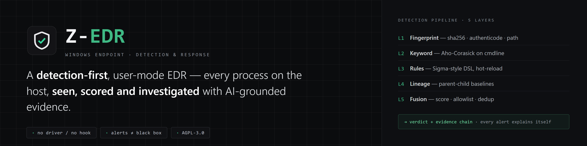
</p>

Z-EDR 在 Windows 与 Linux 终端上记录进程、文件落地、持久化、网络与事件日志
遥测，用五层检测流水线（映射 MITRE ATT&CK）打分，把告警聚类为事件，并为
分析师提供带 AI 研判、实时取证与**人工审批处置**的调查控制台。

全部能力在**用户态、低侵入**前提下实现——**零内核驱动、零 Hook、零进程注入、
不做执行前拦截**。Z-EDR 是 *EDR*（检测与响应），不是 *EPP*（执行前防御），
卸载后不留痕迹。

> **实验性项目**——稳定性不作保证，请先在非关键环境验证后再考虑长期依赖。

---

## 控制台一览

<p align="center">
  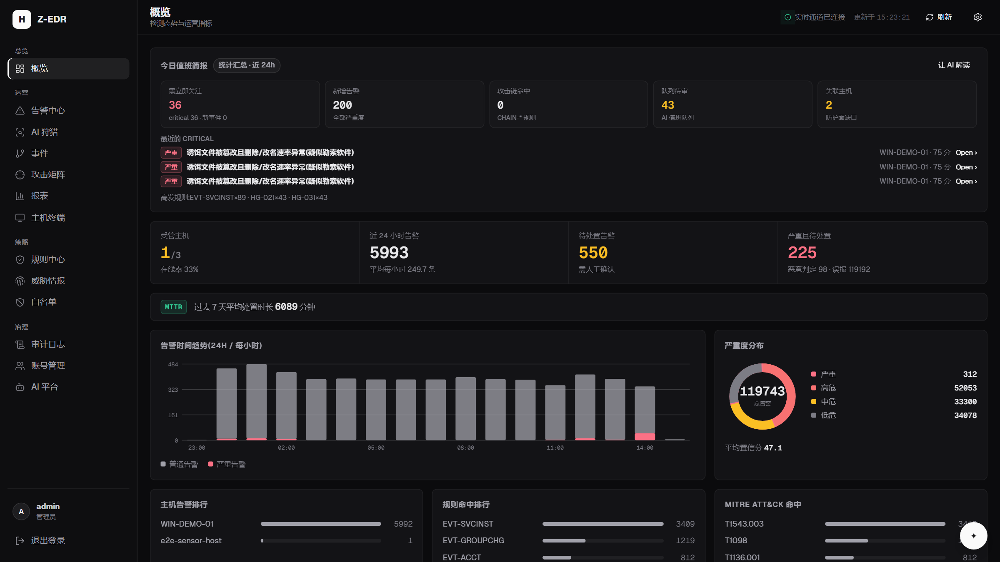
</p>
<p align="center"><sub>今日值班简报（确定性聚合，零模型调用）· 告警趋势与严重度分布 · 主机 / 规则 / ATT&CK 排行</sub></p>

<p align="center">
  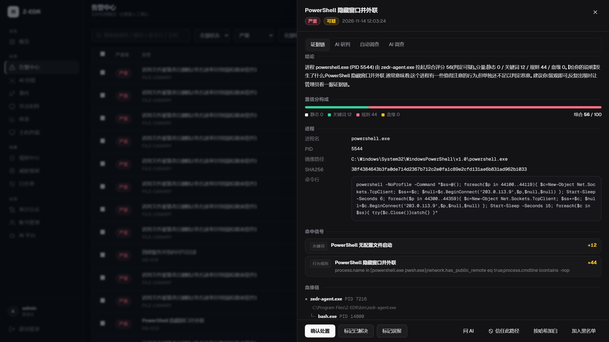
  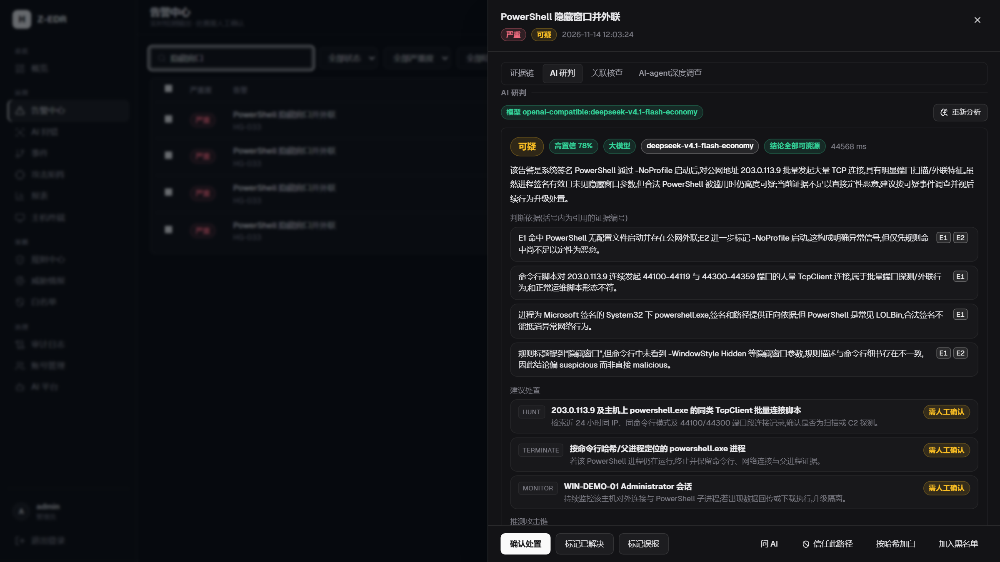
</p>
<p align="center"><sub>证据链与分值构成——左 · AI 研判：每条结论标注证据编号（E1/E2），每个动作等人工确认——右</sub></p>

<p align="center">
  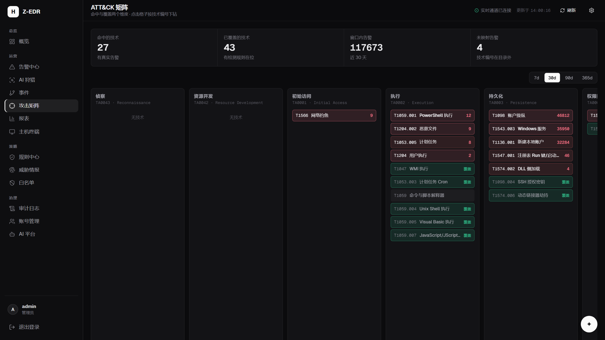
  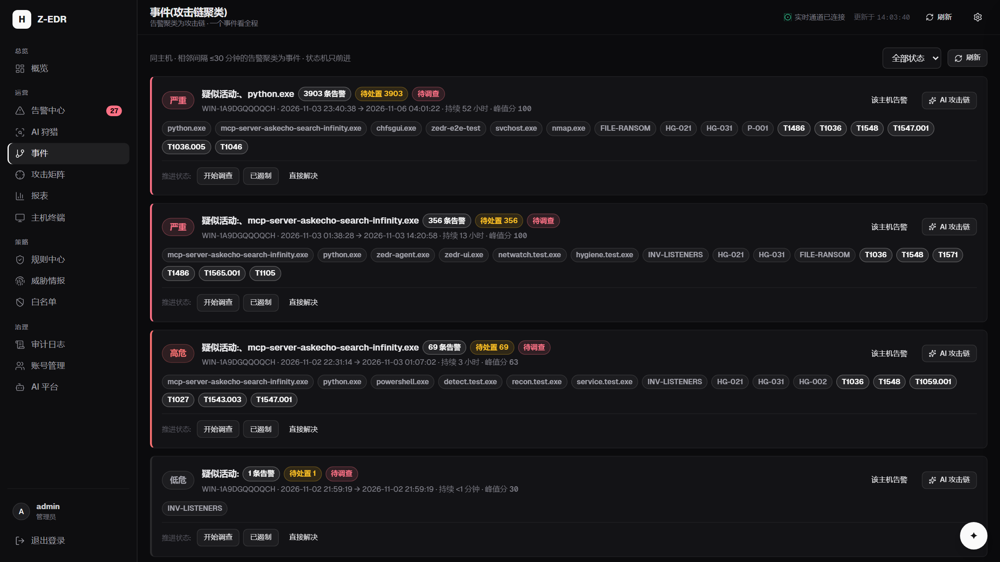
</p>
<p align="center"><sub>ATT&CK 覆盖矩阵（命中 vs 静态覆盖）——左 · 告警聚类为事件链并配处置状态机——右</sub></p>

<p align="center">
  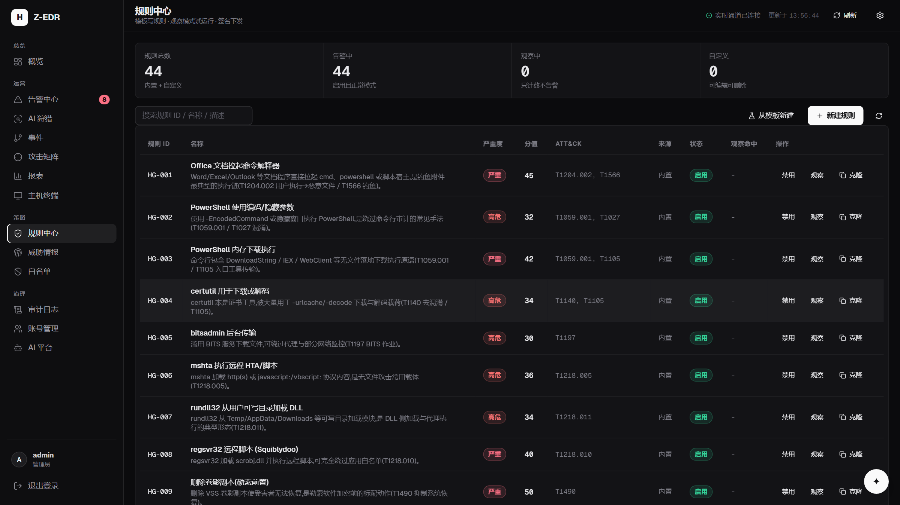
  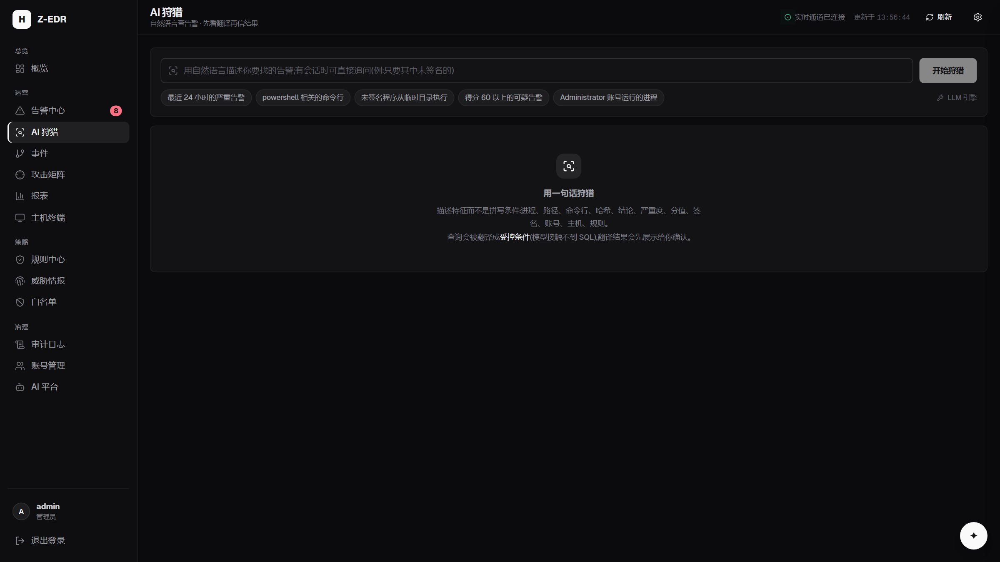
</p>
<p align="center"><sub>规则中心支持观察模式与一键转正——左 · 自然语言狩猎编译为安全 DSL（模型接触不到 SQL）——右</sub></p>

<p align="center">
  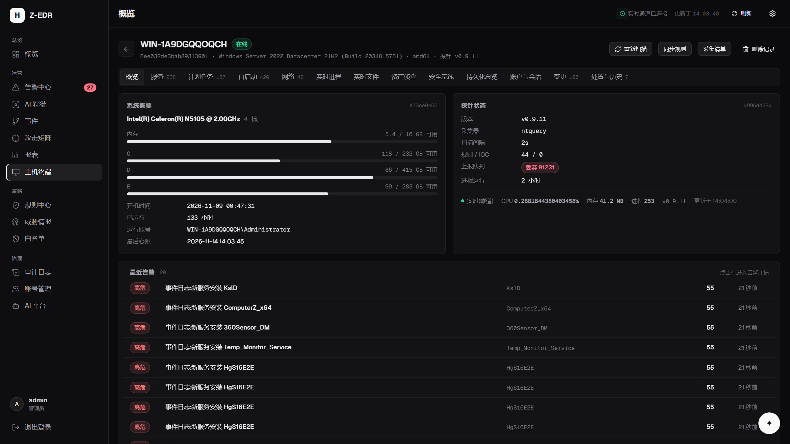
  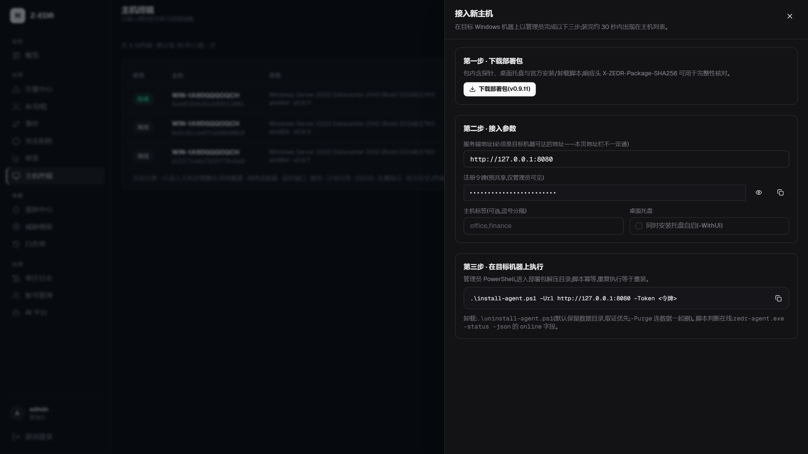
</p>
<p align="center"><sub>主机详情：服务 / 计划任务 / 自启动 / 实时文件 / 资产侦查 / 安全基线 / 账户 / 变更——左 · 三步接入（部署包 + 令牌 + 一条命令）——右</sub></p>

<p align="center">
  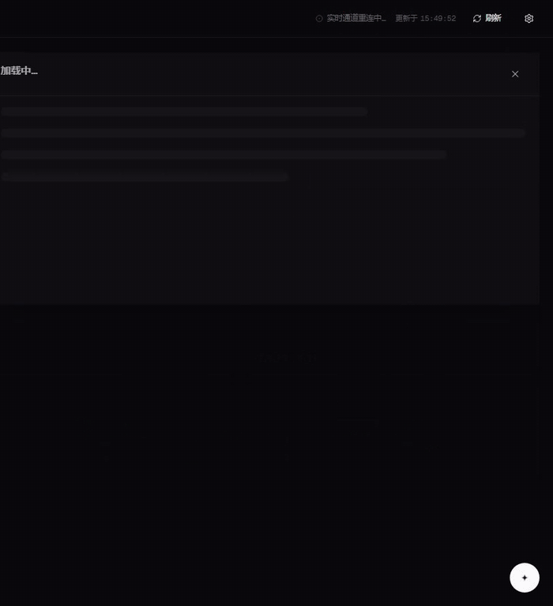
</p>
<p align="center"><sub>一条告警的完整旅程：打开证据链 → 请求 AI 研判——每条结论都引用证据，每个动作都等人工确认</sub></p>

## 核心能力

- **五层检测**——静态指纹、关键词匹配、Sigma 风格 JSON DSL 行为规则
  （服务端下发、热更新）、父子链血缘基线、分值融合。每条告警都带可解释证据链。
- **双平台探针**——同一套五层引擎与检测族在 Windows 和 Linux 上运行：
  Linux 经 procfs 采集、inotify 监听文件变更、以 cron/systemd/ssh 画像
  建持久化基线，并提供回连隧道与实时调查端点（首台机器已在 Kali 2025.4
  验收）；Windows 另有响应处置、内存扫描、事件日志接入与 ETW。
- **宽面行为遥测**——文件落地监控、**USN Journal 断点补采（探针停机期间落地的
  文件，启动后回放）**、持久化项监控（首验只建基线）、注册表自启动键实时守护、
  网络行为检测（端口扫描 / 扫探 / 横向扇出）、勒索防御（透明诱饵 +
  删除/改名速率）、Windows 事件日志接入、主机资产清单变更事件。
- **攻击链关联**——端侧 EQL sequence 式状态机把离散信号串成链
  （落地→执行→C2、持久化→运行、注入→外联），每一阶段回指来源告警。
- **AI 原生调查**——研判结论强制引用证据、抗提示词注入、无模型时确定性降级；
  自然语言狩猎编译为安全 DSL；Agentic 告警自动调查；跨告警事件叙事；
  控制台内 AI 助手；critical 告警值班队列——全部经统一的 AI 配置中心路由：
  按任务槽位配模型、提示词版本化覆盖、预算/缓存热更新、44 条合成夹具 +
  确定性评分器的评测门禁。
- **回连隧道上的实时取证**——探针**零监听端口**：仅出站反连 yamux 隧道，
  本地 HTTP API 经隧道对外服务，管理台、MCP 客户端与 AI 智能体由此实时到达
  30 个只读调查端点（进程、连接、文件、注册表、事件日志、计划任务、服务、
  驱动、登录会话、ARP/路由/DNS 缓存、USN、PE 分析、证据 zip 收集）——
  防火墙收紧的终端照样可用。Agentic 调查靠这条通道拉取终端实时证据，
  而不是只看告警快照。
- **规模化运营**——终端注册 + 三步接入、规则 / IOC / 情报签名下发
  （HMAC，v1/v2 双签名兼容混合舰队）、规则中心（观察模式：观察 → 计数 → 转正）、
  ATT&CK 覆盖矩阵、事件处置状态机与 MTTA、IM/邮件通知、每日备份、
  Prometheus 指标、传感器失联告警、签名探针自升级。
- **人工审批处置**——`terminate` 与文件 `quarantine`/`restore` 受服务端 + 探针
  双层开关控制，**默认关闭**，所有动作进审计。检测演练（五步受控自测）
  同样双层开关、默认关闭。
- **低占用，有实测**——参考主机（约 250 进程、2s 扫描间隔、空闲自适应退避）
  实测 CPU 0.68% / 内存 24.7 MB；单进程检测 ≈25ms；服务端接入 ≈871 条/s。

## 设计原则

**Z-EDR 适合谁：** Windows 与 Linux 混合的终端舰队与桌面、自托管/家庭实验室、
不允许装内核驱动的合规环境，以及要求每个 AI 判定都可回查证据的团队。
**不适合：** 需要执行前拦截（EPP）的场景、需要内核级自保护的对抗环境。
Linux 支持还年轻——首台机器（Kali）刚完成验收、响应处置暂为 Windows 独有，
关键业务的纯 Linux 资产请谨慎评估。

1. **只做检测，不做执行前拦截。** 不挂文件系统过滤、不阻止进程启动——
   事后负责：记录、发现、调查、响应。
2. **用户态、低侵入。** 只用文档化的用户态 API，不修改系统、不注入进程，
   卸载后不留痕迹。
3. **响应是显式可选项。** 没有明确配置与人工审批，什么都不会被杀、不会被动。
4. **诚实接受代价。** 轮询采集对短命进程存在 TOCTOU 盲区，且无自保护——
   实测结果如实发布，包括漏检。见[测试](#测试)与已知边界清单。

## 与同类项目的对比

下表描述各项目撰写时点（2026-11）的公开文档与源码形态，如有出入欢迎指正。

| | Z-EDR | Wazuh | Falco | Velociraptor |
|---|---|---|---|---|
| **定位** | Windows 与 Linux 的 EDR（Linux 实验性）：检测、调查、响应 | 跨平台 SIEM / HIDS 平台 | 云原生 Linux 运行时安全 | 端点可见性与数字取证 |
| **部署形态** | 单服务端二进制（内嵌管理台、SQLite）+ 单探针 | manager + 索引 + 仪表盘多组件栈 | agent + 规则，CNCF 生态 | server + client，VQL 驱动 |
| **采集方式** | 仅用户态 API——零驱动、零 Hook | agent（日志与状态采集） | 内核模块或 eBPF 采集系统调用 | agent（类 osquery 的 artifact） |
| **实时行为检测** | 五层流水线 + 攻击链 + 勒索/网络/事件日志检测器族 | 基于规则的日志分析 + FIM | 系统调用规则引擎 | VQL artifact 监控（取证优先） |
| **AI 辅助调查** | 证据锚定研判、自然语言狩猎、Agentic 调查、事件叙事 | — | — | — |
| **响应模型** | terminate / 隔离，默认关闭、人工审批、全程审计 | active-response 脚本（可配置自动化） | 仅告警（经 Falcosidekick 转发） | 远程 shell / artifact 采集 |
| **适用场景** | 需要 Windows 与 Linux 上逐进程证据与可解释 AI，且不装内核驱动 | 需要带合规内容库的完整 SIEM 栈 | 需要 Linux/容器运行时告警 | 需要深度舰队查询与取证采集 |

## 架构

<p align="center">
  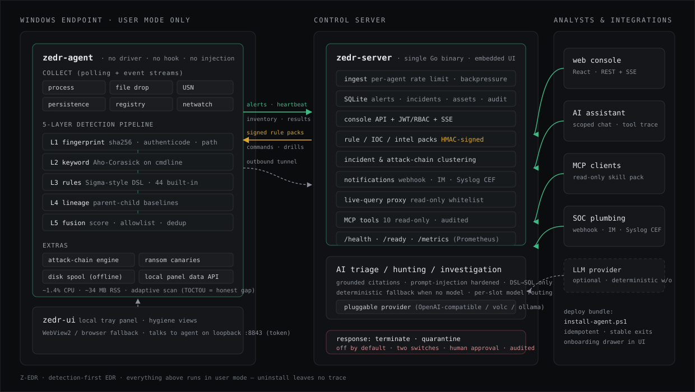
</p>

| 组件 | 二进制 | 职责 |
|---|---|---|
| 总控服务端 | `zedr-server.exe` | REST API、SQLite、内嵌管理台、JWT/RBAC、签名规则/IOC/情报下发、AI 编排、MCP 工具 |
| 终端探针 | `zedr-agent.exe` / `zedr-agent-linux` | 采集 + 检测 + 攻击链引擎 + 上报；Windows 服务安装，Linux 跑在 systemd/supervisor 下 |
| 桌面面板 | `zedr-ui.exe` | WebView2 本机态势与体检窗口（缺失运行时回退浏览器） |
| 采集自检 | `zedr-diag.exe` | 采集层自检（`-compare`、`-persist`、`-usn`、`-hold`、`-spawn`、`-chaintest`、`-netburst`、`-memtestout`） |

## 检测模型

| 层 | 名称 | 典型信号 |
|---|---|---|
| L1 | 静态指纹 | 已知恶意 SHA256、Authenticode（含 catalog 目录签名）、路径信誉 |
| L2 | 关键词 | Aho-Corasick 多模式一次扫描命令行 |
| L3 | 行为规则 | Sigma 风格 JSON DSL 规则，服务端下发、热更新 |
| L4 | 血缘图 | 父子链频次基线、稀有组合、孤儿进程 |
| L5 | 融合 | 阈值定级（≥70 恶意 / ≥38 可疑）、白名单、去重、冷启动静默 |

流水线之外，专职检测器族以独立告警 ID 输出：`CHAIN-*`（攻击链）、
`NW-001..005`（网络行为）、`FILE-CANARY` / `FILE-RANSOM`（勒索防御）、
`EVT-*`（事件日志）、`INV-*`（资产漂移）、`SEN-OFFLINE`（传感器失联）。
检测**演练**可让单台主机端到端彩排五种受控自测（进程链、端口扫描、服务事件、
注册表自启动、诱饵触碰）——全部自造样本、双层开关、默认关闭。

## 快速开始

**环境要求：** Windows 10 / Server 2016+（64 位）；Linux 内核 3.2+（64 位，
Kali 2025.4 已验证）；Go 1.27+，无需 CGO。

```bash
git clone https://github.com/poq79/zedr.git && cd zedr
go mod download
bash scripts/build.sh            # 或：go build -o bin/zedr-server.exe ./cmd/server
cp .env.example .env             # 至少设置 HG_SERVER_JWT_SECRET 与 HG_SERVER_ENROLL_TOKEN
./bin/zedr-server.exe            # 首次启动会打印初始管理员密码（仅一次）
./bin/zedr-agent.exe             # 通过 HG_AGENT_SERVER_URL 指向服务端
```

**Linux 探针**：`bash scripts/build.sh linux` 产出 `bin/zedr-agent-linux`
（含服务端）——拷到目标主机，`HG_AGENT_SERVER_URL` 指向服务端，挂在
systemd 或你的 supervisor 下运行。平台能力差异见[已知边界](#已知边界)。

管理台：`http://127.0.0.1:8080` · 本地面板：`http://127.0.0.1:8843`（仅回环）。

**桌面面板**：运行 `bin\zedr-ui.exe` 得到原生无边框窗口（自绘标题栏、托盘
通知、关闭到托盘）。它自动连接本机探针，探针未运行时会拉起。UI 进程不在
后台常驻——关窗即释放内存，托盘通知器与探针服务继续值守。

检测之外，本地面板带只读体检视图：已装软件（含隐藏卸载器标记）、
Autoruns 式自启动审计（签名 / 文件缺失标记）、安全姿势与补丁检查
（绿黄红 + 理由）、网络暴露面（监听端口 → 进程、主机、代理）、浏览器扩展
盘点——只给证据与指引，不做一键"修复"。

把探针装成 Windows 服务（自动配置失败恢复策略）：

```powershell
.\bin\zedr-agent.exe -install     # 安装并启动，开机自启
.\bin\zedr-agent.exe -uninstall   # 停止并卸载
```

### 部署到第二台机器

管理台「主机终端 → **接入新主机**」给出完整闭环：下载部署包
（探针 + 托盘 + 安装脚本）、复制接入参数、生成一条安装命令：

```powershell
.\install-agent.ps1 -Url http://<总控地址>:8080 -Token <注册令牌> [-Tags 标签] [-WithUI]
```

脚本幂等（重复执行 = 重装），退出码稳定（0 上线 / 2 权限 / 4 参数），
运维平台按 `-status -json` 的 `online` 字段判断接入结果。

全部配置走环境变量（`HG_*`），启动时集中校验——每一项见
[`.env.example`](.env.example) 内的注释。

## 安全默认

| 能力 | 默认 | 开关 |
|---|---|---|
| 终止进程 | **关** | `HG_SERVER_KILL_ENABLED` + `HG_AGENT_KILL_ENABLED` |
| 文件隔离 / 恢复 | **关** | `HG_SERVER_QUARANTINE_ENABLED` + `HG_AGENT_QUARANTINE_ENABLED` |
| 实时文件内容读取 | **关** | `HG_SERVER_LIVEQUERY_FILEREAD` |
| 实时查询（只读） | 开 | `HG_SERVER_LIVEQUERY_ENABLED` |
| 证据 zip 收集 | **关** | `HG_SERVER_LIVEQUERY_COLLECT` |
| 检测演练 | **关** | `HG_SERVER_DRILL_ENABLED` + `HG_AGENT_DRILL_ENABLED` |
| 探针自升级 | **关** | 见 `.env.example` |

处置动作全部进审计、受 RBAC 管控、永不自动执行。

## 接口

- **终端侧**（API-Key）：注册、心跳、告警上报、规则拉取、指令回执、隧道升级。
- **管理台**（JWT）：概览、告警、事件、主机、资产清单、指令、实时查询、
  ATT&CK 矩阵、IOC/情报、规则、白名单、审计、账号、SSE 实时流。
- **MCP 工具**（Bearer 令牌，只读）：告警/事件/情报查询 + `host_live`
  端侧实时取证。每次调用进审计；控制台 AI 助手共享同一套工具。
- **公开**：`/health`、`/ready`、`/metrics`（Prometheus 文本格式）。

所有 `HG_*` 开关——含上方安全默认表——都在 [`.env.example`](.env.example)
里带注释逐项说明。

## 测试

```bash
go vet ./...                          # 静态检查——必须零告警
go test ./...                         # 单元 + 集成（临时 SQLite）
bash scripts/simulate_detection.sh    # 受控端到端验证（仅自造样本）
python scripts/scenarios.py all       # 场景矩阵 / 误报面 / 性能 / 压测
```

测试样本仅限自编二进制、构造的命令行与 EICAR 字符串——**绝不下载外部可执行文件**。
最新一轮实测结果如实发布：**13/17** 剧本场景干净检出（未检出项是有记录的盲区，
不隐瞒）、长期参考主机稳态误报 **0**、4 条攻击链规则 3 条端到端验证通过、
AI 评测门禁（44 条夹具含提示词注入）全绿。

## 已知边界

- 用户态轮询（默认 2s，自适应）可能漏检存活短于一个周期的进程（TOCTOU），
  由文件落地监控与 USN 补采部分补偿；ETW 消费端在 Windows Server 2022 上
  验证未通过，构建标签后禁用。
- 告警投递为 at-least-once（重发由服务端指纹去重吸收）；签名校验走本地
  缓存无在线吊销；情报库手工维护。
- 按设计不做内核级阻断，也无自保护（探针可被终止）。
- **Linux 探针（实验性）**：与 Windows 共享检测引擎与检测器族——procfs
  采集、inotify 文件监听、cron/systemd/ssh 持久化画像、netwatch、攻击链、
  勒索诱饵、回连隧道及其实时调查端点；首台机器已在 Kali 2025.4 验收。
  响应处置、内存扫描、事件日志、ETW、资产侦查与桌面面板为 Windows 独有。

## 贡献

欢迎 Issue 与 PR——提交前确保 `go vet ./...` 与 `go test ./...` 全绿，保持
改动聚焦。克隆后启用本地密钥扫描钩子（`bash scripts/install-hooks.sh`），
提交时自动拦截私钥、主流令牌格式与 `.env` 系列文件。

## 致谢

本仓库每一行代码都由 **GLM-5.3-Flash** 在 ZCode 智能体中编写——感谢 ZCode
每晚免费的闲时 token。

## 许可证

以 **GNU Affero General Public License v3.0**（`AGPL-3.0-only`）发布——见
[LICENSE](LICENSE)。与同类开源 DFIR 平台（如 Velociraptor）一致：修改——
包括通过网络提供服务这一形态——同样必须遵循 AGPL。

Copyright © 2026 poq79
